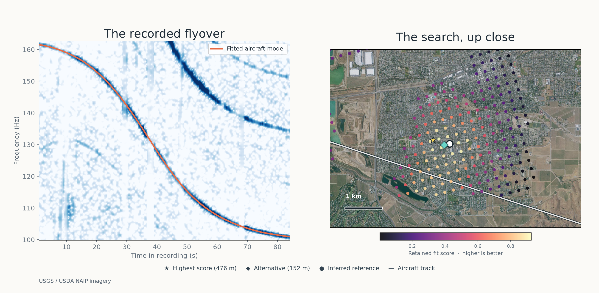

<h1 align="center">DOPPLERGEIST</h1>
<p align="center">Aircraft Doppler Audio Geolocation</p>
<p align="center">
  
</p>

**DOPPLERGEIST** is a source-available Python toolkit for aircraft Doppler audio geolocation. It detects acoustic flyover patterns in recordings, matches them against historical ADS-B flight trajectories, and ranks possible recording locations.

The project provides automatic audio discovery, aircraft-data acquisition, geographic search, and a locally hosted browser interface. It is built for acoustic geolocation research, audio forensics, and studying location information carried by background sound.

<h3 align="center">Example: automatic MP3 analysis</h3>



<sub>A real MP3 was analyzed without manually supplied event windows, frequency bands, or flight IDs. DOPPLERGEIST selected 466 nearby aircraft from a historical flight archive and ranked 105 candidate locations. The leading candidate was **476 m from an inferred reference** in a city-sized search with an approximately 10-second recording-time window. The reference is not surveyed ground truth, and the run remained inconclusive. [View the full experiment and ranking.](docs/LIVERMORE_DEMO.md#all-aircraft-archive-mp3-ranking)</sub>

[Capabilities](#capabilities) · [Quickstart](#quickstart) · [How it works](#how-it-works) · [FAQ](#frequently-asked-questions) · [Results](#validation-and-results) · [Documentation](#documentation-and-references)

## Is Colsto's airplane Doppler geolocation code available?

Colsto did not release the original tools or source code from his [aircraft Doppler geolocation demonstration](https://www.youtube.com/watch?v=UytYrhYLOKI).

**DOPPLERGEIST is an independent implementation**, inspired by the approach in that video. It contains independently written code and is not affiliated with Colsto. If you want to experiment with aircraft Doppler signatures and historical flight-track matching, you can install and run DOPPLERGEIST locally.

## Capabilities

| Capability | What DOPPLERGEIST provides |
| --- | --- |
| **Automatic acoustic discovery** | Scans an entire recording for moving frequency tracks and groups related harmonics, without manually selecting event windows or frequency bands. |
| **Historical aircraft data** | Acquires and indexes ADSB.lol flight archives; caches reusable trajectory, terrain, and geoid inputs. |
| **Location search** | Compares predicted Doppler and sound-arrival patterns across candidate receiver locations, including evidence from multiple independent flyovers. |
| **Geographic profiles** | Search profiles for the contiguous United States, Germany, and Spain, with optional user-provided regional bounds. |
| **Local browser application** | Recording uploads, persistent analysis jobs, inspectable results, progress monitoring, and supported resume/cancellation workflows. |
| **Research and reproducibility** | Configured measurement/replay commands, documented experiments, diagnostic artifacts, and decision rules for unresolved searches. |

The integrated application and command-line workflow are available on `main`. See [how it works](#how-it-works) and [validation and results](#validation-and-results) for the distinction between a ranked hypothesis and an accepted location.

## Quickstart

Requirements: **Python 3.11+**, **FFmpeg** (`ffmpeg` and `ffprobe` on `PATH`), and Git. These commands target Linux and macOS:

```bash
git clone https://github.com/1337isnot1337/DOPPLERGEIST.git
cd DOPPLERGEIST
python -m venv .venv
.venv/bin/python -m pip install .
.venv/bin/dopplergeist --version
```

A compatible C compiler enables optional native acceleration; Python fallbacks are available. For environment checks and alternative installation methods, see [Setup](docs/SETUP.md), [Performance](docs/PERFORMANCE.md), and [Docker](docs/DOCKER.md).

### Option A: use the browser interface

```bash
.venv/bin/dopplergeist serve --jobs jobs --online --max-runtime 14400 --port 8765
```

Open **http://127.0.0.1:8765** and upload a recording. For historical flight matching, supply a supported UTC time window for the **first audio sample**. The interface runs locally; `--online` permits downloading public aircraft and terrain data.

### Option B: analyze a recording from the CLI

```bash
.venv/bin/dopplergeist analyze path/to/recording.mp3 --jobs jobs
```

This creates a persistent job and runs acoustic analysis. To enable historical matching, provide `--start-utc`, `--end-utc`, and `--time-source` with the evidence for the recording clock, plus `--online` if the required data is not already configured locally. Without a defensible recording time, the job reports `needs_input` rather than assuming a date.

For a full online regional analysis, allow enough time for both historical-data acquisition and search. The job limit defaults to **one hour**; initial acquisition can take longer. Replace the sample clock window, source description, and Berlin bounds below with independent evidence for your recording, and increase `--max-runtime` if your data and search scope require it:

```bash
.venv/bin/dopplergeist analyze path/to/recording.mp3 \
  --start-utc "2026-01-01T00:00:00Z" \
  --end-utc "2026-01-01T00:10:00Z" \
  --time-source "replace with the source establishing the first-sample clock" \
  --country DE --bounds 13.0 52.0 14.0 53.0 \
  --online --max-runtime 21600
```

To check progress after the job ID is printed:

```bash
.venv/bin/dopplergeist job JOB_ID --jobs jobs --watch
```

The progress percentage is stage-based and can remain unchanged during long tile subdivisions. Recent search-file activity is a liveness clue, not proof that the queue is shrinking or that a location was found.

The default country profile is `US` (contiguous United States); use `--country DE` for Germany or `--country ES` for Spain. Spain uses a broad geographic envelope, so add independently justified `--bounds WEST SOUTH EAST NORTH` for a regional search. See [country profiles](docs/COUNTRIES.md) and the [local upload workflow](docs/PRODUCT.md) for request options, cancellation, resuming jobs, and upload limits.

**Data requirements:** Initial online acquisition may take hours and tens of gigabytes of disk space, depending on the recording time and search region. Downloads and caches are reusable; the application does not enforce an automatic disk-space cap.

### Option C: discover acoustic events without flight data

```bash
.venv/bin/dopplergeist discover \
  path/to/recording.mp3 \
  --output results/my-discovery
```

This scans the full recording locally without downloading ADS-B archives. Inspect `results/my-discovery/summary.json` and the saved `discovery/` diagnostics. See [Automatic audio discovery](docs/AUDIO_DISCOVERY.md) for detector details and options.

For configured research workflows, `dopplergeist run` and `dopplergeist measure` remain available; see [Methodology](docs/METHODOLOGY.md).

## How it works

1. **Detect the signal.** Decode the recording, identify moving spectral tracks, and group harmonics that may belong to one flyover.
2. **Prepare flight history.** Retrieve or load aircraft trajectories for the recording's supported time window, tracking gaps in available data.
3. **Predict the audio.** Model Doppler shifts and sound-arrival delays from flight paths, receiver geometry, and acoustic propagation.
4. **Rank locations.** Compare modeled and observed signals across geographic candidates and multiple flyovers; preserve alternative explanations when evidence is insufficient.

The software records diagnostic evidence and can return an inconclusive result rather than selecting an unsupported coordinate. The underlying models are described in [Methodology](docs/METHODOLOGY.md) and [Confidence and decision rules](docs/CONFIDENCE.md).

## Frequently asked questions

### Can I geolocate an MP3 recording?

DOPPLERGEIST accepts MP3 recordings and can automatically detect candidate aircraft Doppler events. With a justified recording-time window and appropriate flight data, it can search and rank possible recording locations. A successful location determination is not guaranteed.

### Do I need to know when the recording was made?

**Yes, for historical flight matching.** The software needs a defensible UTC time or bounded time window for the first audio sample. Without that information, it can still analyze the sound, but geographic matching returns `needs_input`.

### Can DOPPLERGEIST run offline?

**Yes, for acoustic discovery.** Location search also works with appropriately configured historical flight and terrain data already available locally. The `--online` flag allows the program to acquire missing public data.

### How accurate is DOPPLERGEIST?

In a constrained real-MP3 demonstration, the highest-ranked location was **476 m from an inferred reference**, not a surveyed microphone position. Independent blind accuracy on real recordings has not yet been established. See [validation and results](#validation-and-results) for both successful fits and unsuccessful evaluations.

### Can I upload an audio file in a browser?

**Yes.** Run `dopplergeist serve` after installation and open the local interface. It is a self-hosted application, not a public cloud upload service.

### Is DOPPLERGEIST free and open source?

DOPPLERGEIST is **source-available, not OSI-approved open source**. It is licensed under [PolyForm Noncommercial 1.0.0](LICENSE), which permits use, modification, and distribution for permitted noncommercial purposes, subject to its terms. Commercial use outside those permissions requires separate authorization; see [Commercial licensing](COMMERCIAL-LICENSING.md).

## Validation and results

DOPPLERGEIST has been exercised on synthetic fixtures, real aircraft recordings, historical flight tracks, and browser/API workflows. These experiments demonstrate components of the pipeline; **no independently accepted blind real-recording localization has yet been established**.

| Experiment | Observed result | How to interpret it |
| --- | --- | --- |
| **Automatic Livermore MP3, regional all-aircraft archive** | Selected and searched 466 nearby aircraft and returned 105 ranked locations; the first was **476 m from an inferred reference**. | Fully automatic event selection, but a constrained region and approximate 10-second clock window; the reference is not surveyed truth and the result was inconclusive. [Details](docs/LIVERMORE_DEMO.md#all-aircraft-archive-mp3-ranking). |
| **Configured two-flyover real-audio replay** | Leading location **43.86 m from a public reference**. | Used source-informed events and geographic bounds; the reference is not surveyed, and the model did not accept a location. [Clean replay](docs/verification/CLEAN_REPLAY.md). |
| **40 real smartphone aircraft recordings** | Automatic discovery produced candidate acoustic groups in **36 of 40** files. | These are acoustic proposals, not verified aircraft detections or geolocation successes. [Discovery results](docs/AUDIO_DISCOVERY.md). |
| **Five public field recordings** | Three returned rankings, with no retained candidate within 1 km of the publisher-reported sites; two returned no candidate. | Recorder clocks and exact microphone positions were not confirmed, so these are development outcomes rather than a calibrated accuracy benchmark. [Experiment](docs/PUBLIC_RECORDING_EXPERIMENT_2026-11-03.md). |
| **NASA and WSU measured-trajectory recordings** | Produced mixed detection results and no validated automatic location. | Original real-data tests, including unsuccessful cases. [Verification](docs/verification/WORKER_E2E_2026-11-03.md) and [NASA benchmark](benchmarks/README.md#real-nasa-supplied-trajectory-session-benchmark). |

Searches depend on acoustic evidence, reliable recording-time information, sufficient historical flight coverage, and physical-model support. A ranked score is not a calibrated location probability, and incomplete or competing hypotheses may lead to an **inconclusive** decision. Full experimental conditions, negative findings, and reproducibility records remain available in the linked reports.

### Performance engineering

Optional native backends, reuse of acoustic calculations, and checkpointed search are implemented and measured. In one pinned bounded regional HTTP replay, optimizations reduced elapsed time from **62.03 seconds to 37.19 seconds (1.67×)** without changing the compared scientific outputs. This is a workload-specific result, not a general national-search runtime claim. See [measured performance and reproduction](docs/PERFORMANCE.md#measured-native-computation-and-bounded-reuse) and [data/search architecture](docs/DATA_AND_SCALE.md).

## Documentation and references

- [Local upload workflow](docs/PRODUCT.md) — browser UI, API, job monitoring, limits, cancellation, and resume.
- [Methodology](docs/METHODOLOGY.md) — Doppler geometry, trajectory fitting, and acoustic propagation.
- [Automatic audio discovery](docs/AUDIO_DISCOVERY.md) — acoustic detector design and evaluation.
- [Data acquisition and geographic search](docs/DATA_AND_SCALE.md) — ADS-B archives, indexing, terrain, coverage, and search.
- [Country profiles](docs/COUNTRIES.md) — supported search domains and regional configuration.
- [Confidence and decision rules](docs/CONFIDENCE.md) — candidate interpretation and inconclusive outcomes.
- [Performance](docs/PERFORMANCE.md) and [pipeline measurements](docs/PIPELINE_PERFORMANCE_2026-11-03.md) — measured optimizations and comparisons.
- [Livermore demonstration](docs/LIVERMORE_DEMO.md), [real-data verification](docs/verification/WORKER_E2E_2026-11-03.md), and [benchmark instructions](benchmarks/README.md) — recorded experiments and reproduction.
- [Finite-search evidence](docs/FINITE_SEARCH_PRODUCER.md) and [scoring assessment](docs/SCORING_ASSESSMENT.md) — candidate accounting and coverage of evaluated hypotheses.
- [Setup](docs/SETUP.md), [Docker](docs/DOCKER.md), and [data provenance](docs/DATA_SOURCES.md) — installation, deployment, and third-party data terms.

## License

DOPPLERGEIST is distributed under the **[PolyForm Noncommercial License 1.0.0](LICENSE)** (`PolyForm-Noncommercial-1.0.0`). It is **source-available, not OSI-approved open-source software**. Noncommercial uses, modification, and distribution are permitted subject to the license. Commercial use not otherwise permitted requires authorization from the relevant rights holders. See [Commercial licensing](COMMERCIAL-LICENSING.md).

Recordings, aircraft archives, terrain datasets, and other third-party materials retain their own licenses, rights, and attribution requirements.

## Contributing and development

Contributions, reproducible test recordings with appropriate permissions, documentation improvements, and independently verifiable evaluations are welcome. See [CONTRIBUTING.md](CONTRIBUTING.md), the [issue tracker](https://github.com/1337isnot1337/DOPPLERGEIST/issues), and the [development discussion](https://github.com/1337isnot1337/DOPPLERGEIST/discussions/39).

Created by **Cinna Davis** with extensive AI-assisted development. Thanks to @henriklied, @EirikAskheim, @kleindotc, and other contributors. Follow updates on [X](https://x.com/1337isnot1337) or [LinkedIn](https://www.linkedin.com/in/cinna-davis/).

## Star history

<p align="center">
  <a href="https://www.star-history.com/#1337isnot1337/DOPPLERGEIST&Date">
    <picture>
      <source media="(prefers-color-scheme: dark)" srcset="https://api.star-history.com/svg?repos=1337isnot1337/DOPPLERGEIST&type=Date&theme=dark" />
      
    </picture>
  </a>
</p>
