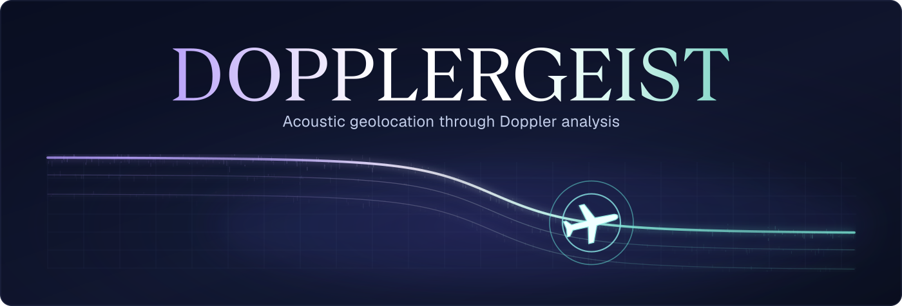

<p align="center">
  
</p>

DOPPLERGEIST investigates **where an audio recording was made** by comparing the Doppler patterns of passing aircraft with historical flight trajectories. It combines acoustic measurements, aircraft motion, sound travel time and terrain to rank possible recording locations. The application runs locally; there are no plans for a hosted service.

**Experimental software.** The local upload application and automatic audio-to-decision pipeline are available on `main`, alongside configured research replays. Independent nationwide accuracy on real recordings has not been established. A plausible coordinate alone is insufficient evidence for a location.

[Quickstart](#quickstart) · [How it works](#how-it-works) · [Results](#experimental-results) · [Documentation](#documentation-and-references)

## Quickstart

Requires **Python 3.11+**, **FFmpeg** (`ffmpeg` and `ffprobe` on `PATH`) and Git. Install FFmpeg through your operating system's package manager, then run from a shell on Linux or macOS:

```bash
git clone https://github.com/1337isnot1337/DOPPLERGEIST.git
cd DOPPLERGEIST
python -m venv .venv
.venv/bin/python -m pip install -e '.[test]'

.venv/bin/python scripts/make_synthetic_cases.py
.venv/bin/aircraft-geoloc run \
  data/synthetic/known-time-minute.json \
  --output results/known-time-demo
```

This generates deterministic audio and flight tracks, then runs a **configured synthetic localization experiment** with a known recording clock and a selected 60-second event. It needs no external datasets or data-service credentials. Inspect `results/known-time-demo/report.json` for the leading hypothesis, `ranked.json` for alternatives, and the PNG plots for diagnostic comparisons. The historical checkpoint identified the correct flight with **40.87 m error**; this is a synthetic result, not a real-world accuracy claim.

Use a new output directory for each experiment. Run the tests with `.venv/bin/python -m pytest -q`. For pinned environments and clean-install evidence, see [Setup](docs/SETUP.md); native Windows execution has not been verified.

### Discover events in a recording

Automatic discovery scans an entire recording for moving acoustic frequency patterns **without hand-selecting event windows or frequency bands**:

```bash
.venv/bin/python scripts/discover_audio.py \
  path/to/recording.mp3 \
  --output results/my-discovery
```

Read `results/my-discovery/summary.json` and the diagnostics under `discovery/`. **These are acoustic event proposals, not coordinates or certified aircraft detections.** See [Audio discovery](docs/AUDIO_DISCOVERY.md) for settings, evidence and failure modes.

### Analyze an upload locally

```bash
.venv/bin/aircraft-geoloc serve --jobs jobs --config path/to/operator.json
```

Open `http://127.0.0.1:8765` to upload audio and supply a defensible recording-start
UTC window. The application discovers events, searches the configured flight data,
refines hypotheses and returns a supported or inconclusive decision. See
[Local upload workflow](docs/PRODUCT.md) for operator configuration, the equivalent
`analyze` CLI command, saved jobs and cancellation. Flight and terrain data must be
configured; installing the application alone does not supply a historical archive.

## How it works

1. **Measure the audio.** Decode the recording, identify frequency tracks, and group harmonics that belong to the same flyover.
2. **Collect trajectories.** Retrieve aircraft positions for a justified recording-time window and track available data coverage.
3. **Model the sound.** Predict Doppler frequency and arrival time from aircraft trajectories, receiver geometry, and sound propagation.
4. **Compare locations.** Search candidate receiver positions, reconcile independent flyovers, and retain competing explanations rather than forcing an answer.

The central complication is that the plane **moves while its sound travels**. DOPPLERGEIST models emission time separately from reception time. See [Methodology](docs/METHODOLOGY.md) for equations, assumptions, and implementation details.

## Capabilities and limits

- **Available on `main`:** the local upload interface, persistent jobs, HTTP API and automatic `analyze`, `serve` and `job` commands, plus `run` for configured localization experiments, `measure` for selected acoustic events, and `scripts/discover_audio.py` for discovery alone. Automatic jobs connect intake, discovery, flight indexing, tiled search, multi-flyover matching, physical refinement and conservative decisions.
- **Still open:** [end-to-end acceptance](https://github.com/1337isnot1337/DOPPLERGEIST/issues/13), independent real recordings and robustness evaluation. Landing the application does not establish accuracy or calibrated confidence.
- **Not independently validated:** nationwide geolocation accuracy on real recordings, calibrated location probabilities, and the false-localization rate of the acceptance rules.

The target is a supported location estimate within **1,000 m**, preferably **100–500 m or better**, using real recordings without truth-informed event selection or geographic bounds. Evaluation reports 100/500/1,000 m thresholds without rewriting historical experiments' original thresholds.

Recording-time evidence matters: audio-relative seconds do not identify which day's flights to search. A defensible start time or bounded UTC window is needed; file modification and upload times do not establish the recording clock. All supported independent flyovers share one clock, while harmonics count once and unconfirmed proposals may remain unmatched.

Missing events, incomplete flight coverage, competing locations or inadequate sensitivity evidence can require an **inconclusive** outcome. Ranking scores and sensitivity envelopes are not calibrated probabilities. The configured research CLI emits ranked hypotheses; it does not execute the complete upload acceptance workflow. Trajectory interpolation and physically inconsistent input motion also remain [documented limitations](research/trajectory-motion/README.md). See [Decision rules](docs/CONFIDENCE.md).

## Experimental results

The published project artifacts preserve both successful fits and cases where the system could not justify a location.

| Experiment | Reported finding | Important qualification |
| --- | --- | --- |
| Independent synthetic, two events | **21.89 m** error, correct flight pair | Original configured checkpoint; unknown start time, three candidate regions, truth withheld from search |
| Clean synthetic two-event replay | **15.40 m** error | Ridge measurements and winner changed; cause unresolved, not an exact reproduction |
| Known-time synthetic flyover | **40.87 m** error, correct flight | Manually configured 60-second event |
| Original real recording, two flyovers | **43.86 m** from a public reference coordinate | Source-informed regional bounds and event windows; reference coordinate is **not surveyed ground truth** |
| Original faint real flyover | **357.47 m** from the same reference | Clock inherited from the two-event fit; missed its original 100 m target |

The two real-regional winners reproduce in a clean environment. See the [clean replay report](docs/verification/CLEAN_REPLAY.md) and [CI replay evidence](docs/CI_VERIFICATION_2026-11-02.md) for measurements and provenance.

Automatic pipeline results require a different reading:

- **Event discovery:** frozen synthetic fixtures with three, four and six flyovers yielded **13/13** discovered events with unchanged settings. This establishes detection on those fixtures, not accepted localization. See [multi-event fixtures](docs/MULTI_EVENT_FIXTURES.md).
- **Full synthetic national searches:** one product-integration run processed **4,940** coarse tiles and ranked a hypothesis **1,046,023 m** from truth first; the correct flight pair was fourth at **6.16 m**. A separate browser/API upload on another integration revision led with a candidate **0.65 m** from truth. **Both ended inconclusive** because alternatives remained unresolved. Neither is an accepted automatic location. See [integration evidence](docs/verification/INTEGRATION.md), [product run](https://github.com/1337isnot1337/DOPPLERGEIST/pull/19) and [upload replay](https://github.com/1337isnot1337/DOPPLERGEIST/pull/32).
- **Real acoustic benchmarks:** the [annotation-assisted feature benchmark](docs/PROGRESS.md) detected **33/40** passages, with median speed/slant errors of **6.85% / 15.37%** among detections. Separate automatic discovery produced **102 proposals across 28/40 recordings**; these are not certified aircraft detections. Corrected 300-second Times Square and Statue of Liberty webcam clips each yielded **zero supported proposals** under frozen settings. These datasets lack the established recorder clock and microphone-coordinate evidence needed for location-accuracy validation. See [discovery results](docs/AUDIO_DISCOVERY.md), [timing audit](docs/verification/REAL_DATA_TIMING.md) and [public-camera benchmark](docs/verification/PUBLIC_CAMERA_BENCHMARK.md).

### Replay the historical reference case

Large research inputs live in checksummed release assets. With an authenticated GitHub CLI (`gh`) that can access the release, restore only the regional replay's required bundles:

```bash
.venv/bin/python scripts/restore_artifacts.py \
  --bundle data-source --bundle data-adsb-derived --bundle data-terrain
.venv/bin/aircraft-geoloc run \
  data/source/reproduce-local.json \
  --output results/my-reference-replay
```

The restorer checks hashes and preserves conflicting local files. The original source YouTube MP4 is not redistributed. See [artifact restoration](docs/ARTIFACTS.md) and the [checkpoint release](https://github.com/1337isnot1337/DOPPLERGEIST/releases/tag/checkpoint-2026-11-02).

## Documentation and references

- [Methodology](docs/METHODOLOGY.md) — geometry, Doppler and acoustic propagation
- [Installation and reproducibility](docs/SETUP.md) — environments, verification, restoration
- [Automatic event discovery](docs/AUDIO_DISCOVERY.md) — detector design and known failure modes
- [Confidence and decision rules](docs/CONFIDENCE.md) — ambiguity, abstention, incomplete coverage
- [Integration verification](docs/verification/INTEGRATION.md) — end-to-end results and caveats
- [Data and search contracts](docs/DATA_AND_SCALE.md) — trajectory indexing, coverage and geographic search
- [Implementation handoff](docs/HANDOFF.md), [acceptance issue](https://github.com/1337isnot1337/DOPPLERGEIST/issues/13) and [development discussion](https://github.com/1337isnot1337/DOPPLERGEIST/discussions/39) — ongoing work; the handoff includes historical context and is not a current feature inventory

DOPPLERGEIST is an **independent reconstruction** of the approach described in [colsto's video](https://www.youtube.com/watch?v=UytYrhYLOKI), with independently written code. It is not a release by or affiliation with the video's author. External recordings, ADS-B and terrain assets retain their own rights and attribution requirements; see [data provenance](docs/DATA_SOURCES.md). The banner's outlined typography and illustrative model are documented in [asset notes](assets/README.md).
