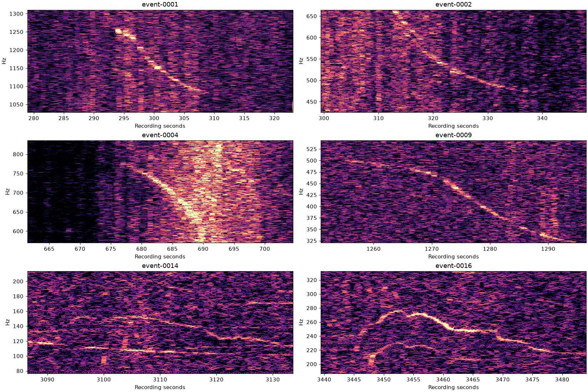
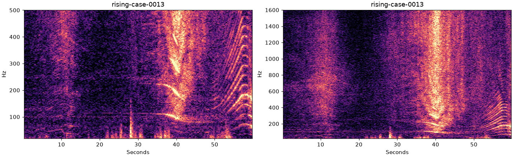
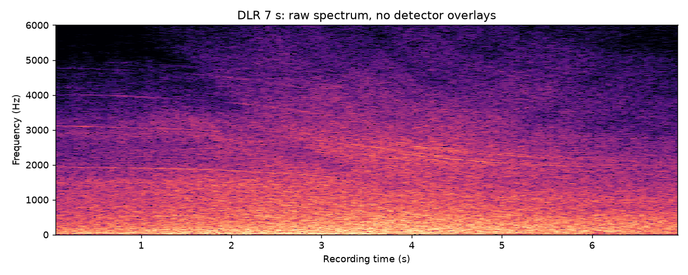
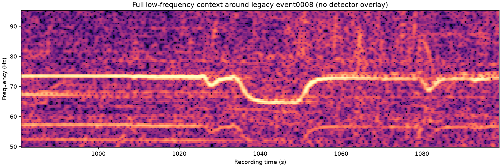
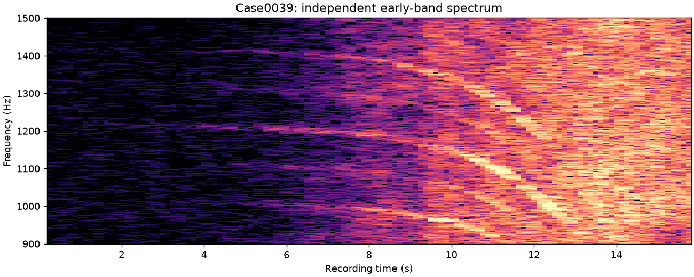

# Real-recording acoustic repair comparison

[Engineering report](../../docs/ACOUSTIC_EPISODES_REPAIR.md),
[fixed protocol](protocol.md), and
[original source/rights/hash manifest](../acoustic-episodes-349/manifest.json).
No audio is included. All32 original inputs are retained, including ambiguous,
zero, missed and operational-failure outcomes. No generated signals are used.

The baseline is451b67f; before-repair PR is3447e33; the repaired detector is
9b4ea5839638d17cb3127071c294a48a4b644972. The production scanner remains unchanged.
This is a draft follow-up to merged#356, not a merged production replacement.

- `selection.json`: exact original case selection, source pins, environment and watchdog.
- `operational-failures.json`: failed intermediate budget/watchdog experiments, kept separate from valid zero-proposal results.
- `comparison.csv`: every selected input and all three default-band arms; counts,
  one-to-one retention, separate partial coverage, extras, possible merging,
  runtime, CPU time where available, peak RSS and output volume.
- `matches.json`: explicit one-to-one assignments, unmatched references, retained
  point fractions, observed temporal overlap, endpoint differences and review flags.
- `observations.jsonl.gz`: unchanged actual discovery artifacts for all32inputs
  and three arms, including measured children, canonical memberships, diagnostics,
  effective settings and code identities.
- `wide.csv`, `wide-observations.jsonl.gz`: all31 wider-coverage results, compared
  with the same legacy references; high-band extras are not aircraft labels.
- `coverage-comparison.csv`: matching repaired narrow-band proposals to repaired
  wider-band proposals on the same originals. This includes decoding effects;
  identical-PCM band-normalization invariance is a separate automated check.
- `prediction-ablation.json`: identical decoded samples, spectra, selected peaks
  and assignment; only prediction tolerance changes. Old and repaired continuity
  checks are then applied to the same observations.
- `target-causes.json`: bounded per-target trace summaries for the six lost paths,
  including their first splitting stage and measured rejection thresholds.

The one-to-one matcher is `scripts/compare_acoustic_repairs.py`. Its references
are old proposals, not an exhaustive annotation or physical-source truth.
A matching additional proposal is called a duplicate **review flag**; genuinely
independent near-unison sources cannot be certified or counted from this set.
Other extras are unverified proposals, including confusing machinery/wildlife and
background contexts. They are not silently reclassified as true detections.

Raw independent spectra, computed before candidate judgment:

- 
- 
- 
- 
- 

AeroSonicDB measurements/images are attributed to Downward and Nordby,
[CC BY-NC4.0 source](https://zenodo.org/records/10215080). DEMAND measurements are
attributed to Thiemann, Ito and Vincent,
[CC BY-SA3.0 source](https://zenodo.org/records/1227121). DLR uses the
[CC BY4.0 RECORD139 source](https://zenodo.org/records/20494053) and existing
[documented extraction](../dlr-record139-scanner-check-20261103.md).
Reference-audio redistribution permission is unestablished; only factual derived
measurements and diagnostic spectra are included. Existing processing and hashes
remain unchanged. No aircraft, emitter-count, motion or localization truth is
inferred from these observations.

The final catalogs use the frozen numerical detector in9b4ea58. Subsequent
reporting-only changes add count semantics and correct failed-gate diagnostics;
the saved comparisons are not rewritten. Earlier600s watchdog/budget failures
remain in `operational-failures.json`. Final runs use the same1800s external
watchdog for every selected repaired input. The hour still exceeds600s.

The new independent carrier-context review does not remove legacy0008 from any
reference denominator. Source labels and observations are unchanged. Narrow-to-
wide one-to-one misses are reported alongside raw measurement retention and
consolidation flags; a changed group count is not treated as proof of improvement.
