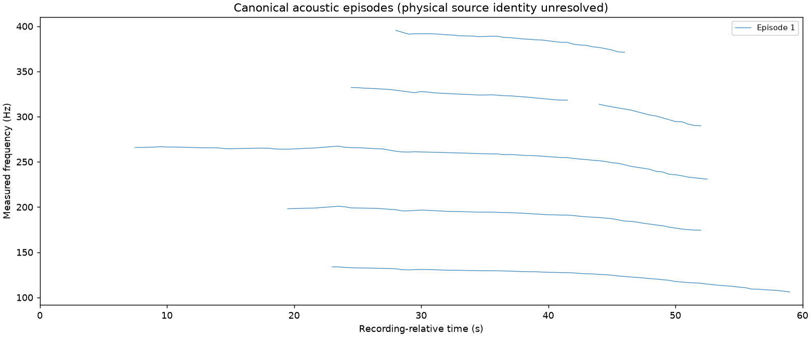
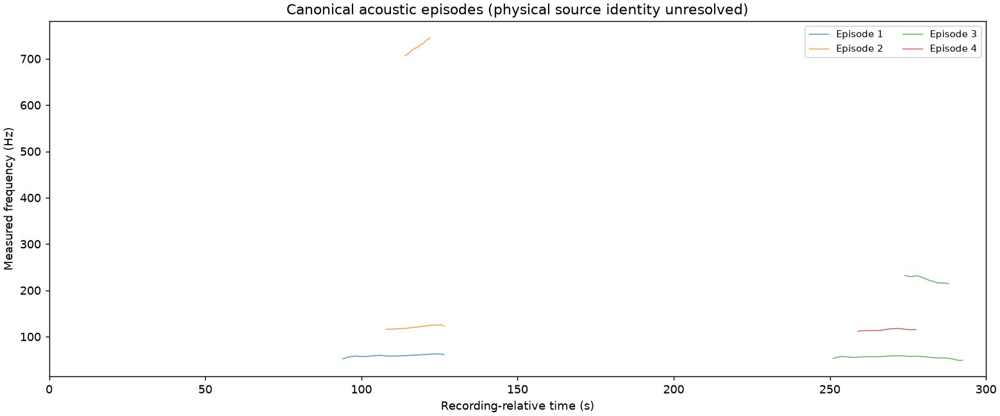

# Acoustic episodes: implementation and real-recording comparison (#349)

The experiment changes the acoustic proposal model, fragment ordering, elapsed-time
checks and frequency-coverage contract. It does **not** demonstrate better aircraft
recall, physical-source identification or localization. Some real baseline
signals regress, and wider coverage returns additional confusing-source proposals.

## Integration status

The integrated implementation is an experimental acoustic-report path in
`dopplergeist.episode_discovery`. The installed `discover` command and checkout
scanner require `--experimental-episodes` to select it. Default discovery retains
the existing version-1 scanner. Automatic analysis and upload jobs retain that
scanner too.

The frozen results below describe the historical experiment. Labels such as
`new default` mean the experimental implementation with its original settings.
They do not identify the current product default. The integration preserves all
measurements, zeros, misses, and reported runtime regressions. It does not
establish new end-to-end results or location accuracy.

The matching adapter also corrects indexing after an ineligible group is skipped.
Its regression uses recorded measurements and changes only eligibility metadata.
Generated coordinate-array tests are excluded from the integration and CI.

The integration also corrects child duration and support diagnostics that a loop
flag overwrote. Canonical group acceptance computes duration independently. The
frozen artifacts retain their historical child diagnostics, including those
incorrect values. Their measurements and results remain unchanged.

## Historical source revisions

Starting `origin/main`: `451b67f01dcd1dfe44d47c42407f404706a5a9b7`.
Worktree: `/home/cinna/dopplergeist-acoustic-episodes`, branch
`feat/acoustic-episodes`. The historical comparison is pinned in benchmark commit
`05548ed1cb0954db8fac960523e39300dc97308d`; detector code is frozen in a separate
validation checkout. The subsequently merged optional coherent adapter retains
its legacy helpers and passes its own recorded Michigan-trace tests. That
adapter was not used to supplement or improve this comparison.

## Engineering choices

The canonical episode catalog references all measured children. Constant-scale
fits replace a ratio-dictionary/base-ridge grouping decision. They require
resolved shared motion and temporal support; noninteger relationships also need
measured envelope agreement. Multi-component groups need multiple witnesses and
one consistent scale model over every supported pair. This intentionally leaves
some related fragments split when their relationship cannot be resolved without
single-link chaining. An unresolved relation is not evidence of source independence.

Provisional four-observation paths survive through chunk deduplication and
continuation association before duration rejection. Observation cells, gaps,
prediction residuals, uncertainty and episode support determine acceptance.
Brief events have a stronger, separately exposed path. Linking and rejection use
actual seconds in both directions, with a one-turn allowance rather than a
compulsory descending template. Source motion remains unconfirmed.

A bounded higher-rate single-spectrum path avoids band-duplicate accounting and
selects decoding rate before discarding frequencies. Experimental settings default to 40–1600 Hz;
20 Hz lower coverage and 6000 Hz upper coverage were exercised separately.
Coverage, work limits, failures, input/code identities and runtime are explicit.
Normal noise diagnostics aggregate counts and measured/threshold ranges. Group
plots render once, and the matching adapter consumes fitted scales once per
canonical episode, retaining the legacy path for old events. See
[the experimental command and artifact contract](AUDIO_DISCOVERY.md#experimental-acoustic-episodes).

## Inputs, expectations and inspection

The [32-input manifest](../benchmarks/acoustic-episodes-349/manifest.json) includes
SHA-256, public source, rights, processing, context and predeclared expectations.
No new media is committed. Unique source duration is approximately 157 minutes:

- First two publisher-aircraft and first two publisher-background clips in each
  location stratum of the existing seed-20261103 AeroSonicDB sample: six 60-second
  aircraft-context clips and six 10-second background-context clips. Downward
  and Nordby, [AeroSonicDB v1.1.2](https://zenodo.org/records/10215080), CC BY-NC 4.0.
- The existing seven-second center-microphone DLR RECORD139 excerpt, with the
  documented constant gain: [source and exact extraction](../benchmarks/dlr-record139-scanner-check-20261103.md),
  [publisher record](https://zenodo.org/records/20494053), CC BY 4.0.
- All 18 available full, unpadded, channel-1 DEMAND recordings, about 300 seconds
  each, including home machinery, nature, public spaces and transport. Thiemann,
  Ito and Vincent, [DEMAND](https://zenodo.org/records/1227121), CC BY-SA 3.0.
  Existing extracted 16 kHz media were reused and individually identified by
  checksum; upstream ZIP integrity was not rechecked during this task.
- The existing hour-long public-reference WAV from the source release, identified
  separately from its MP3 representation. Redistribution permission for the
  original source is unestablished; only derived measurements are saved here.

Every fixed case is retained, including zero and unfavorable results. No filename
exceptions, flight data, coordinates or trajectory fits enter discovery. Context
labels do not certify source identity or aircraft absence. The selection is a
small development set, not a sealed holdout or a calibrated false-positive sample.

Before judging final replays, spectra without proposal overlays were reviewed
for the six aircraft-context clips. The clear family in case-0001, the descending
family in case-0033, and the clearly rising structure at about 50–59 seconds in
case-0013 are useful acoustic checks. Cases 0002, 0039 and 0008 have broadband
masking or weak continuity; their ambiguity remains explicit. These visual
judgments are qualitative, not exhaustive event annotations. They did not change
the frozen expectations to match output counts. Detailed views of the reference
proposals and transport/nature controls were also inspected. No audio playback
or physical-source labeling was used.

## Measured behavior

All 32 experimental cases at default settings and all 31 wider-coverage cases completed. The hour-long
input was not run at 6 kHz in the wider arm. The complete
[case table](../benchmarks/acoustic-episodes-349/comparison.csv) and compressed
[measured observations](../benchmarks/acoustic-episodes-349/observations.jsonl.gz)
retain the negatives, child tracks, canonical memberships, diagnostics and code
identities. Counts below are acoustic proposals.

| Input/context | Old groups / children | Experimental 40–1600 Hz episodes / children | Experimental 40–6000 Hz |
| --- | ---: | ---: | ---: |
| Six aircraft-context clips | 2 / 6 | 2 / 9 | 3 / 12 |
| Six background-context clips | 0 / 0 | 0 / 0 | 0 / 0 |
| DLR seven-second flyover | 0 / 0 | 0 / 0 | 0 / 0 |
| Eighteen DEMAND contexts | 2 / 2 | 7 / 10 | 14 / 19 |
| Hour-long reference | 16 / 18 | 30 / 38 | Not run |

The wider arm still proposes in the **same two of six** aircraft-context clips;
its third proposal is additional multiplicity in case-0001, not recovery of a
third clip. The old 12-second gate made its background zeros inevitable on
10-second clips. The new brief path is duration-eligible there, but six zero
results still do not estimate a population false-alarm rate.

Case-0001 has six measured children in one episode, versus three in the old
output. The bounded family model reports orders `[4,3,2,5,6,5]`, compatible with
an unobserved fundamental; no fundamental ridge is invented. Fourteen supported
pair comparisons agree with the joint scale model, worst residual 0.541 of its
limit, and minimum two resolved-motion witnesses. Observed support extends from
36.5 to 50.0 seconds. This is useful component consolidation, not proof of one
physical source. Missing/fragmented order-5 observations remain separate measured
children in that episode.



The reference has three brief-path proposals: 900–909 s, 2149–2154.5 s and
2163–2169 s. The latter two lack ten total samples and are marked acoustic-review
only. Gaps are preserved. DEMAND car/bus contexts contain retained rising and
turning tonal trajectories; their engine/environment context illustrates why
motion acceptance cannot be called aircraft detection. Near-unison reference
trajectories remain separate when they do not satisfy the common-motion model.



Regressions are material:

- At the experimental default settings, proposal-positive aircraft clips remain 2/6. The visibly rising
  case-0013 remains missed, including a separate 0.5-second-window / 0.125-second-hop,
  20–6000 Hz replay. DLR's seven-second excerpt is also still missed. Supporting
  brief events does not guarantee recovery of fast, broadband or weak passages.
- In the reference, only 628/805 old measured points (78.0%) have a coincident
  new observation within `max(1 Hz, 0.006*f)`. This overlap measure uses actual
  timestamps and is **not recall**. Six old groups have no such retained points:
  293.5–308.5, 314–333.5, 676–690, 1265.5–1282, 3101–3119 and 3454–3469.5 seconds.
  The 1265.5–1282-second ridge is the documented faint-passage regression.
- The old reference groups around 2100–2178.5 and 3060.5–3121 seconds each map
  onto two new groups. Thus partial-family reconciliation remains conservative,
  and the new representation does not solve all fragmentation. Unresolved
  associations and source multiplicity must not be counted as certified
  independent sources.
- The union of reference observed time across all accepted tracks grows from 353.0 to 599.5 seconds, but additional
  accepted tones are unverified. DEMAND gains nature, bus and car proposals and
  loses its old metro proposal. These are confusing-source positives and a lost
  baseline control, not aircraft successes. Wider coverage adds living-room and
  river-context proposals too.

No obviously incompatible trajectory was found within the reviewed case-0001
family, but the data provide no certified simultaneous-source truth. An accidental
physical-source merging rate cannot be estimated here. The historical branch used
generated coordinate-array checks for simultaneous evolution, near-unison retention,
weak bridges, and witness reconciliation. Those checks do not provide real-recording
evidence and are excluded from the integration and CI.

## Coverage, boundaries and operational cost

With identical 40–1600 Hz analysis, case-0001 decoded at 4 and 16 kHz retains one
episode and six children. Across 275 coincident measurements, the 90th-percentile
frequency difference is 4.42e-7 Hz (well below resolution). Its 40/20-second
chunk/overlap replay retains one episode but five children; changing the lower
limit to 20 Hz also retains one episode/five children. Chunk whitening and band
normalization can change marginal components. IDs are stable for fixed measured
content, not promised invariant across different configurations. The high-rate
path has no band seam; overlapping chunk observations have raw provenance and
one canonical catalog. Frequency requests above available decoding/source
coverage, too narrow to form a peak, or on an unsupported sample/hop grid fail
explicitly. Under-window real excerpts are valid zero-observation results;
corrupt media and execution/budget failures are separate failures.

| Replay | Sum wall time (s) | Peak RSS (MiB) | Total discovery output (KiB) |
| --- | ---: | ---: | ---: |
| 31 inputs, old 40–1600 Hz | 120.58 | 173.3 | 1400.0 |
| 31 inputs, new 40–1600 Hz | 247.29 | 146.2 | 1503.9 |
| 31 inputs, new 40–6000 Hz | 421.57 | 267.6 | 1618.1 |
| Hour, old 40–1600 Hz | 39.99 | 172.7 | 321.3 |
| Hour, new 40–1600 Hz | 54.11 | 163.1 | 527.3 |

Times include intake, hashing, discovery and one summary plot, in separate case
processes on a contended host. These are single-arm operational observations,
not causal speedups. The experimental 40–1600 Hz living-room case is a notable runtime regression
because retained noise fragments require reconciliation. The reference retained
2,541 provisional paths / 22,966 observations and used about 14.5k association
work units, below configured budgets. Normal output has no file per rejected
fragment. The 6 kHz arm demonstrates the additional FFT/candidate cost; it is not
the default or a calibrated better detector.

## Reproduction and checks

Restore the real media to the manifest paths and verify the supplied hashes.
The original reference WAV can be restored from the repository's source-only
release asset as described in [artifacts](ARTIFACTS.md); no ADS-B archive is
needed. AeroSonicDB filenames, DEMAND archive names and the DLR transformation are
in the manifest. Use a fresh directory for each run.

The following commands compare the historical baseline with the current experimental
implementation. They produce new results and leave the frozen comparison intact.
`--source-root` selects the detector checkout. The experimental arms require
`--experimental-episodes` and a checkout that contains `episode_discovery.py`.

```bash
git worktree add --detach /tmp/dg-old 451b67f01dcd1dfe44d47c42407f404706a5a9b7

.venv/bin/python scripts/validate_acoustic_episodes.py \
  --manifest benchmarks/acoustic-episodes-349/manifest.json \
  --source-root /tmp/dg-old --output results/episodes-old
.venv/bin/python scripts/validate_acoustic_episodes.py \
  --manifest benchmarks/acoustic-episodes-349/manifest.json \
  --source-root . --output results/episodes-new --experimental-episodes

# Same 31 inputs for the wide arm; the full hour was predeclared outside this arm.
python - <<'PY'
import json
from pathlib import Path
m=json.loads(Path('benchmarks/acoustic-episodes-349/manifest.json').read_text())
m['cases']=[c for c in m['cases'] if c['id']!='whole-reference']
Path('/tmp/episodes-wide-inputs.json').write_text(json.dumps(m))
PY
.venv/bin/python scripts/validate_acoustic_episodes.py \
  --manifest /tmp/episodes-wide-inputs.json --max-frequency-hz 6000 \
  --source-root . --output results/episodes-wide --experimental-episodes
.venv/bin/python scripts/summarize_acoustic_episodes.py \
  --manifest benchmarks/acoustic-episodes-349/manifest.json \
  --baseline results/episodes-old --new results/episodes-new \
  --wide results/episodes-wide --output results/episodes-comparison

PYTHONPATH=src .venv/bin/python -m pytest -q tests/test_real_episode_artifact.py \
  tests/test_real_episode_motion.py tests/test_real_episode_cli.py
```

For the exact historical experiment, use the runner from its pinned checkout.
That runner predates the explicit switch and imports its experimental detector
from `dopplergeist.discovery`. The current runner's explicit switch cannot select
that historical module layout.

```bash
git worktree add --detach /tmp/dg-frozen 05548ed1cb0954db8fac960523e39300dc97308d
.venv/bin/python /tmp/dg-frozen/scripts/validate_acoustic_episodes.py \
  --manifest benchmarks/acoustic-episodes-349/manifest.json \
  --source-root /tmp/dg-frozen --output results/episodes-frozen
```

For the historical wide arm, use that same archived runner with the 31-input
manifest and `--max-frequency-hz 6000`. Use a separate output directory. Neither
historical replay supplies location truth or performs trajectory fitting.

After the frozen comparison, a reporting-only patch replaced the combined
episode-rejection reason with explicit failed gates on both acceptance paths.
The final matching adapter consumes the joint scale model without reimposing a
single-base overlap requirement. All 63 new/default-wide observed outputs adapt
successfully (50 matchable canonical episodes), with no trajectory fitting.
A pre-integration real replay matched the frozen rich-family clip's complete
`events` and `episodes` exactly and exposed the new rejection ranges.

The pre-integration report recorded 69 passing focused checks. That historical
count included generated coordinate-array tests for grouping, motion, and rejection
properties. Those tests are removed and do not support the integrated validation
claim. The count also included real measured-child compatibility, legacy coherent
compatibility, execution errors, and checkpoint checks. It is not the current CI
test total.

The same historical report recorded successful compilation, CLI help,
benchmark-instrumentation checks, and installed-wheel checks. Its signal recordings
were the genuine inputs above. The current recorded-artifact test uses saved real
children and the eligibility-metadata regression. The motion regression checks
duration and support diagnostics against recorded child measurements. The CLI
check packages each of two recorded four-second PCM excerpts separately, without
changing samples. It checks default and experimental routing, default decode
bytes, and explicit rejection of unsupported source frequency coverage. These
checks do not establish aircraft identity, detection recall, or localization
accuracy.

The remaining limits are measured recall losses, ambiguous source multiplicity,
fragment splits, uncertain peak/contrast models, and uncalibrated confidence and
confusing-source rates. A future detector change needs separate real controls;
this evidence does not establish flight identity, localization accuracy or a
nationwide end-to-end result.

## Repair follow-up (2026-11-04)

The historical results above remain unchanged. The separate
[repair report](ACOUSTIC_EPISODES_REPAIR.md) traces the six lost signals on identical
samples, documents bounded reversible fragment association and safe interleaving,
and compares original451b67f, pre-repair PR3447e33 and the repaired opt-in scanner.
It includes unfavorable inputs, partial coverage, additional confusing-source
proposals and operational failures. The follow-up PR is draft and unmerged;
none of this changes the production discovery route or establishes aircraft
identity, physical motion, source multiplicity or localization accuracy.
