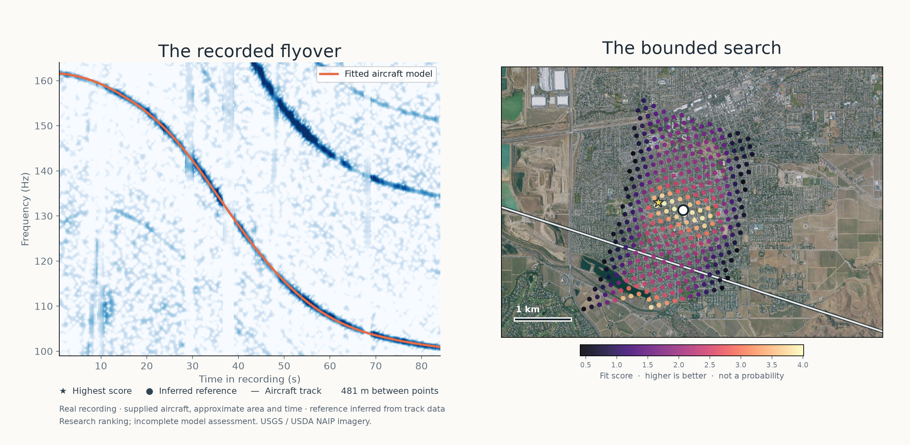

# A bounded real-audio demonstration: Livermore



This is a configured research run on **N784MB_R04**, a smartphone recording and
an accompanying aircraft track from [Praveen Pathak's Livermore dataset](https://doi.org/10.5281/zenodo.23424278)
(CC BY 4.0). We ran DOPPLERGEIST at `8c19362` on the original WAV and the
published KML track. The plot overlays the best physical model on the recording
and shows scored grid points for its selected track segment. Colors are raw fit
scores, not probabilities; locations with no plotted point were not assigned a
score in this visualization.

The highest-scoring point is **481 m from an inferred reference**, not surveyed
microphone ground truth. That reference was reconstructed from published flight
tracks and reported closest-track offsets across the same dataset; the dataset
does not publish an exact microphone coordinate. The search region was chosen
with that inferred site in mind, so this separation is **not an independent
measurement of location accuracy**. The candidate is within 500 m and 1,000 m
of the inferred reference, but not 100 m; the unknown reference error prevents
those figures from establishing those accuracy thresholds.

The configured run supplied one aircraft's track, the recording's full 0–85 s
window and the 99–164 Hz band, a roughly 10-second start-time interval derived
from the published UTC ridge and WAV duration, and a regional search box. The
published ridge constrains sample zero only if the entire annotated passage is
within this audio file; it is not an independently measured recording clock.
The midpoint was `2026-05-14T17:41:32.238656Z`, with a ±5.01 s scoring sweep
in 0.5 s steps. The winner lies at the early edge of that sweep, 0.01 s earlier
than the estimated lower bound; its clock is therefore particularly sensitive to
the imposed boundary. Terrain was held at 150 m above mean sea level with an
EGM96 geoid conversion. The run scored 358 grid points and retained 407 rows
including refinements. Its model assessment is incomplete: one track segment was
unsupported at each of three CPA stages, and all 407 scored candidate clock
envelopes were unclassified by the legacy brightness scorer. The program marked
`accepted_location: false`. One pass also permits competing geometries; the
plot does not rule them out.

A separate fresh configured two-flyover replay on the same code placed its
leading candidate 43.86 m from an approximate public reference, also with
incomplete model support. Both are development examples, not automatic or
independent real-world acceptance. The Livermore run took 20.7 seconds on the
local machine; runtime depends on hardware and load.

## Reproduce

Install the project as described in the [README](../README.md). Download
`Raw data_V_constant_H_constant.zip` from the dataset page, verify its published
MD5 `d34b32ae57477074d6e8563300a7fc19`, and extract the `N784MB_R04` folder.
Obtain an EGM96 geoid raster compatible with DOPPLERGEIST, for example
`data/terrain/us_nga_egm96_15.tif` from the project checkpoint's `data-terrain`
bundle. Use new output directories:

```bash
PYTHONPATH=src python scripts/prepare_livermore_demo.py \
  path/to/V_constant_H_constant/N784MB_R04 \
  data/terrain/us_nga_egm96_15.tif results/livermore-prepared
PYTHONPATH=src python -m dopplergeist.cli run \
  results/livermore-prepared/config.json --output results/livermore-run
```

The imagery in the figure comes from [USGS The National Map / USDA NAIP](https://imagery.nationalmap.gov/arcgis/rest/services/USGSNAIPImagery/ImageServer).
To reproduce the graphic, download the public-domain USGS image for the fixed
extent and pass it to the renderer:

```bash
curl -G 'https://imagery.nationalmap.gov/arcgis/rest/services/USGSNAIPImagery/ImageServer/exportImage' \
  --data-urlencode 'bbox=-121.82,37.642,-121.74,37.687' \
  --data-urlencode 'bboxSR=4326' --data-urlencode 'imageSR=4326' \
  --data-urlencode 'size=1600,900' --data-urlencode 'format=jpg' \
  --data-urlencode 'f=image' -o results/livermore-naip.jpg
PYTHONPATH=src python scripts/render_livermore_demo.py \
  results/livermore-run results/livermore-naip.jpg results/livermore-demo.png
```

The live imagery service may serve a newer aerial image in the future. See
[Dopplerprint comparison](DOPPLERPRINT_REVIEW_2026-11-03.md) for the limits of
the related dataset's reconstructed reference and other real-data work.
