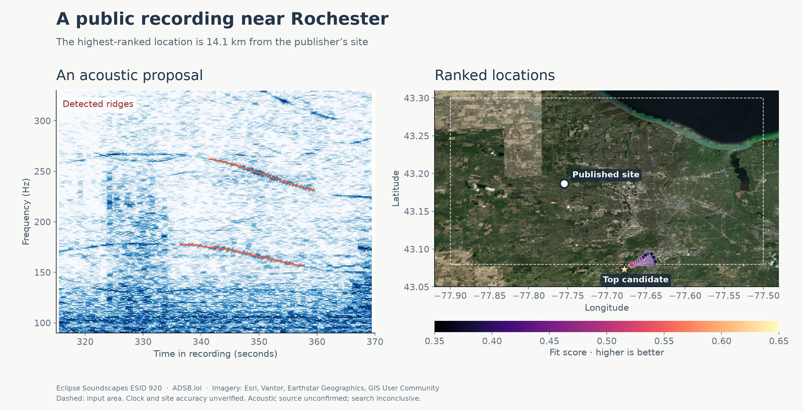

# Public field recordings: regional end-to-end tests

Five real, ten-minute recordings from the public Eclipse Soundscapes archive were
submitted as MP3s to the local HTTP pipeline on source `611dca2`. Three produced
rankings, but **none of their 105 retained rows lay within 1 km of the
publisher's site**. The other two produced no candidate. These are negative or
inconclusive development tests, not confirmed aircraft-localization benchmarks:
the audio proposals have not been independently identified as aircraft, and the
individual clock and microphone-position errors are unknown.



| Recording | UTC filename start | Groups | Tiles visited | Outcome | Top distance | Closest retained |
| --- | --- | ---: | ---: | --- | ---: | ---: |
| [ESID 920, Rochester area](https://zenodo.org/records/22014438) | 02:41:49 | 6 | 16/16 | 105 rows; `search_incomplete` | 14.06 km | 13.48 km, rank 101 |
| [ESID 430, Fort Worth area](https://zenodo.org/records/21772857) | 05:27:00 | 5 | 12/12 | 105 rows; `source_drift_unresolved` | 12.38 km | 12.38 km, rank 1 |
| [ESID 439, east Texas](https://zenodo.org/records/21804576) | 02:09:50 | 6 | 12/12 | 105 rows; `search_incomplete` | 22.27 km | 19.41 km, rank 101 |
| [ESID 443, Denton area](https://zenodo.org/records/21755346) | 04:53:15 | 1 | 9/9 | No ranked candidates; `search_incomplete` | — | — |
| [ESID 923, Charlottesville area](https://zenodo.org/records/21918793) | 08:39:17 | 4 | 12/12 | No matching flights | — | — |

All dates are 8 April 2024. Groups are detector harmonic-group IDs, not proven
independent aircraft. Distances are WGS84 distances to the site coordinates
reported by the publisher, not measured microphone errors. The audio comes from
the first 600 seconds of each UTC-named WAV and was encoded to MP3. The
publisher describes the filenames as UTC and reports the AudioMoth time-chime
setup; neither establishes the actual clock error at these sites. The ±20-second
clock windows below are **assumptions**, not verified uncertainty bounds.

The experiments supplied approximate regional boxes selected with knowledge of
the published sites, so they are **not blind location tests**. They did not supply
flight IDs, event windows, frequency bands or exact coordinates to the search.
They used the ADSB.lol all-aircraft 2024-04-08 archive index (including unknown
types), Copernicus GLO-90 terrain, the EGM2008 geoid, 1,500 m coarse spacing,
150 m fine spacing, and the full automatically discovered events. Archive scope
is not proof that every real aircraft was received. The detector's proposal and
an aircraft fit do not themselves establish the physical source of a sound.

## Rankings and search limits

- [ESID 920: all 105 ranked rows](../benchmarks/results/public-eclipse-920-ranked-20261103.csv)
- [ESID 430: all 105 ranked rows](../benchmarks/results/public-eclipse-430-ranked-20261103.csv)
- [ESID 439: all 105 ranked rows](../benchmarks/results/public-eclipse-439-ranked-20261103.csv)

Scores are fit statistics, not probabilities; repeated or nearby rows need not
be independent locations. Rochester's first five geographically separated
candidates (500 m separation) occur at original ranks 1, 2, 6, 14 and 20, with
site distances 14.06, 13.88, 13.96, 14.27 and 13.74 km respectively. The
Rochester winner matched one detector group; the remaining groups were unmatched.
The output also contains unknown model evaluations: 50 unsupported CPA work
evaluations, 87 unclassified candidate evaluations and 515 unknown clock trials.
Completed tiles therefore do not imply complete physical-model assessment.

**Bounds defect:** five Rochester and five east-Texas final rows, including each
rank-one result, are outside their requested latitude/longitude search boxes.
The saved coarse and fine tiled rankings for Rochester were within bounds; the
final refinement/profiling stage allowed points outside. The results are retained
unaltered and the figure draws the requested box. They must not be represented as
an exhaustive or strictly bounded ranking until that behavior is corrected. The
initial Denton run also lacked terrain at one edge; a fresh rerun with both DEM
tiles produced the row in the table.

## Reproduction

The source records are linked above. The field collector in
[`collect_eclipse_audio.py`](../scripts/collect_eclipse_audio.py) extracts the
first 600 seconds of a UTC-named WAV and encodes MP3. The ten-minute local MP3s,
full job results and operator configurations used here remain under
`/home/cinna/.local/state/dopplergeist-eclipse-corpus-20261103/` and
`/home/cinna/.local/state/dopplergeist-public-eclipse-run-20261103/`. Original
media are not redistributed in this repository.

With an acquired MP3, a locally built all-aircraft index, terrain and geoid, run:

```bash
PYTHONPATH=src python scripts/run_public_eclipse_case.py \
  --audio /path/to/esid-920.mp3 --operator-config /path/to/operator.json \
  --output /path/to/new-output \
  --start-utc 2024-04-08T02:41:29Z --end-utc 2024-04-08T02:42:09Z \
  --bounds -77.90 43.08 -77.50 43.30
```

The saved operator configuration uses `flight_indexes`, `terrain.rasters`,
`terrain.geoid_raster`, `search_workers: 3`, and `search_budget` with
`spacing_m: 1500`, `tile_cells: 8`, `top_k: 100`, `refine_spacing_m: 150`,
`refine_finalists: 5`. The second and third ranked runs used two workers. The
full retained ranking can be exported after the job with
[`export_ranked_job.py`](../scripts/export_ranked_job.py); the reference coordinate
is a post-search comparison. The figure is generated by
[`render_public_eclipse_case.py`](../scripts/render_public_eclipse_case.py) from
the saved recording, result, candidate CSV and Esri World Imagery export. Esri
and contributors retain the rights to the basemap; see
[Esri's static-map attribution terms](https://doc.arcgis.com/en/arcgis-online/reference/static-maps.htm).
